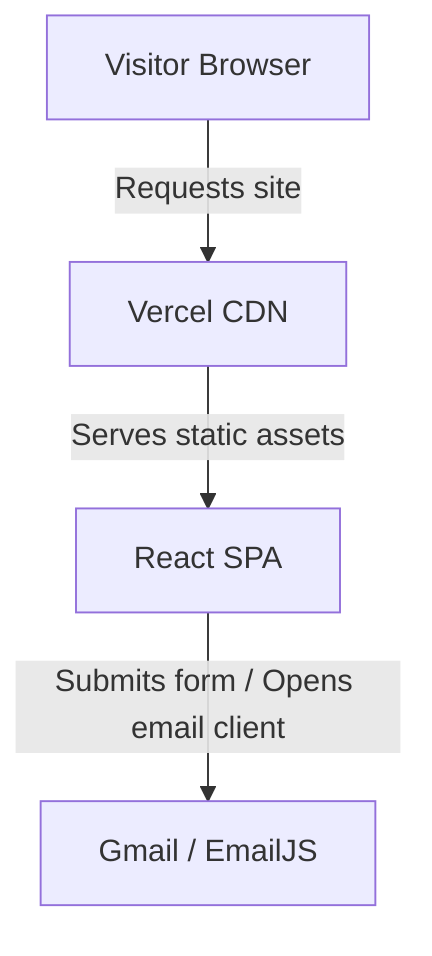

**Read online:** [https://dawoodijaz1999.github.io/Doc-bot/docs/Portfolio.html](https://dawoodijaz1999.github.io/Doc-bot/docs/Portfolio.html)

> Auto-generated from [dawoodijaz1999/Portfolio](https://github.com/dawoodijaz1999/Portfolio) at commit `502494d` on 2026-10-21.

# Dawood Ijaz — Portfolio — System Documentation

**Repo:** https://github.com/dawoodijaz1999/Portfolio · **Purpose:** Personal portfolio showcasing skills, experience, and projects for a full-stack engineer · **Cost:** Free, open-source ($10/year optional custom domain) · **Runs:** Client browser via Vercel hosting

## 1. Architecture overview

The portfolio runs entirely client-side as a single-page application built with React and Vite, rendered and hosted statically on Vercel. Contact interactions open the visitor's mail client or trigger EmailJS integration directly from the browser.

## 2. Tools and technologies used
| # | Tool | Purpose | Cost / Limits | Docs (domain only) |
|---|---|---|---|---|
| 1 | React | UI component library | Free, open-source | react.dev |
| 2 | Vite | Build tool and dev server | Free, open-source | vitejs.dev |
| 3 | EmailJS | Optional contact form email dispatch | Free tier limits | emailjs.com |
| 4 | Vercel | Hosting and static deployment | Free tier | vercel.com |

## 3. Project file structure
```text
portfolio/
├── index.html         # Main HTML entry point with meta tags and fonts
├── package.json       # Project dependencies and npm scripts
├── vite.config.js     # Vite configuration file
└── src/
    ├── main.jsx       # React root rendering entry
    ├── App.jsx        # Main application component and intersection observer hook
    ├── index.css      # Global styles, variables, and theme definitions
    ├── components/
    │   ├── Navbar.jsx           # Top navigation bar
    │   ├── Navbar.module.css    # Navbar styles
    │   ├── Footer.jsx           # Page footer
    │   └── Footer.module.css    # Footer styles
    └── sections/
        ├── Hero.jsx             # Hero intro section
        ├── About.jsx            # About me and contact info card
        ├── Skills.jsx           # Technical skills grid
        ├── Experience.jsx       # Professional work experience timeline
        ├── Projects.jsx         # Key projects showcase
        └── Contact.jsx          # Contact form and links
```

## 4. Configuration (environment variables)
None. (EmailJS credentials and project links are configured directly inside `src/sections/Contact.jsx` and `src/sections/Projects.jsx`).

## 5. External accounts required
- GitHub: Used for repository hosting and automated Vercel deployments.
- Vercel: Used for hosting and deploying the static web application.
- EmailJS: Used optionally for routing contact form submissions directly to Gmail.
- Namecheap: Optional registrar for purchasing a custom domain.

## 6. Known limitations
- Placeholder links: Projects default to `#` for GitHub and live demos unless manually replaced in `src/sections/Projects.jsx`. Workaround: update URLs before going live.
- EmailJS credentials: Contact form defaults to opening a mailto/Gmail window unless EmailJS service, template, and public keys are supplied in `src/sections/Contact.jsx`.

## 7. Manual/recurring tasks (not automated)
| Task | Frequency |
|---|---|
| Update project items and work experience in component files | As needed |
| Update GitHub repo URLs and live demo links | As needed |

## 8. Reusability for future projects
- The component layout and CSS module structure can be reused for other developer portfolios or single-page landing sites.
- Intersection observer hooks (`useReveal`) inside components can be adapted for scroll-triggered fade animations.
- The Vite and React build pipeline configuration can serve as a template for static SPAs.
