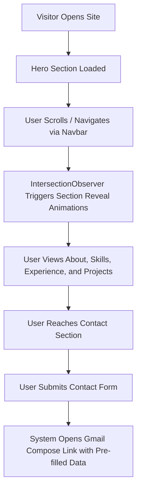

**Read online:** [https://dawoodijaz1999.github.io/Doc-bot/docs/Portfolio.html](https://dawoodijaz1999.github.io/Doc-bot/docs/Portfolio.html)

> Auto-generated from [dawoodijaz1999/Portfolio](https://github.com/dawoodijaz1999/Portfolio) at commit `502494d` on 2026-10-21.

1. Dawood Ijaz Portfolio — Full Stack & Backend Engineer Portfolio Application

## At a Glance

| Parameter | Value |
| :--- | :--- |
| **Inputs** | User navigation actions, contact form details (name, email, message) |
| **Outputs** | Rendered portfolio UI, Gmail contact compose link generation |
| **Time** | Local setup: &lt; 2 minutes; Deployment: ~5 minutes |
| **Cost** | Free (Hosted on Vercel; source code hosted on GitHub) |
| **Platforms** | Web browsers via Vercel deployment |

## Problem It Solves

Provides a clean, professional, and responsive web presence for Dawood Ijaz to showcase full-stack and backend engineering capabilities, professional work history, technical skills, and key projects to recruiters and prospective clients.

## What It Does (Features)

- **Hero Section**: Introduces the engineer with dynamic headings, short professional summary, Quick statistics counters, and call-to-action buttons.
- **About Me Section**: Provides a detailed professional background, soft skills tags, and direct communication contact channels (Email, Phone, WhatsApp, LinkedIn).
- **Technical Skills Matrix**: Categorizes expertise across Frontend, Backend, State & Styling, and Tools & Cloud environments.
- **Work Experience Timeline**: Details professional roles, dates, company assignments, and core engineering accomplishments.
- **Project Showcase**: Displays production projects (Muebly, TCC, Phrase Lab AI, Camera by Centennial, Holos, WanderLust, Bummbuu, MERN Blog App) complete with tech stacks and links.
- **Interactive Contact Form**: Captures name, email, and message inputs to generate a pre-filled Gmail compose link for direct communication.
- **Responsive Navigation**: Includes a fixed, blurring navbar with smooth-scrolling section links and a mobile hamburger menu.
- **Scroll Reveal Animations**: Implements IntersectionObserver hooks to gracefully reveal elements as users scroll down the page.

## Full Workflow, Step by Step



## Architecture

The application is built as a single-page React application bundled via Vite. It uses a component-driven architecture separating global UI containers (`Navbar`, `Footer`) from modular page content sections (`Hero`, `About`, `Skills`, `Experience`, `Projects`, `Contact`). Styling is handled via modular CSS files alongside global configuration rules in `src/index.css`.

## Tools and Technologies

| Tool | What It Is | Role in This Project | Cost |
| :--- | :--- | :--- | :--- |
| **React.js** | JavaScript library | UI component construction and state management | Free |
| **Vite** | Frontend build tool | Local development server and production bundling | Free |
| **CSS Modules** | CSS styling approach | Scoped component styling | Free |
| **EmailJS Browser SDK** | Third-party service SDK | Email handling documentation / integration support | Free |
| **Vercel** | Cloud hosting platform | Production web hosting and continuous deployment | Free |
| **Git / GitHub** | Version control | Code repository management and version tracking | Free |

## Inputs and Outputs

- **Inputs**:
  - Scroll events and window viewport metrics.
  - User click actions on navigation links and external profile cards.
  - Form field values: `name`, `email`, `message`.
- **Outputs**:
  - Fully rendered, responsive HTML/CSS/JS portfolio interface.
  - Dynamic `window.open` trigger opening a pre-populated Gmail compose URL.

## Reliability and Error Handling

- Form validation ensures that the user name, email, and message fields must not be empty before triggering submission.
- Defensive code checks for element references during IntersectionObserver setup (`if (!el) return`).
- Fallbacks for responsive design breakpoints to ensure readability across mobile devices.

## Security

- No secret values or API tokens are hardcoded into public repository files.
- Configuration placeholders are provided for services like EmailJS (`EMAILJS_SERVICE_ID`, `EMAILJS_TEMPLATE_ID`, `EMAILJS_PUBLIC_KEY`).
- Standard `.gitignore` rules prevent local environment files (`.env`), build directories (`dist/`), and dependency folders (`node_modules/`) from being committed.

## Setup and Configuration

1. Install project dependencies:
   ```bash
   npm install
   ```
2. Start the local development server (opens at `http://localhost:5173`):
   ```bash
   npm run dev
   ```
3. Update project GitHub/Live demo links in `src/sections/Projects.jsx`.
4. Configure EmailJS keys in `src/sections/Contact.jsx` if using direct API email sending.

## Usage Guide

- Browse sections by clicking navigation links in the header or scrolling down the page.
- Review technical competencies and project cards to evaluate past work.
- Use the contact form or direct links in the About/Contact sections to reach out via Email, WhatsApp, Phone, or LinkedIn.

## Maintenance Tasks

- Periodically run `npm update` to check for dependency updates.
- Keep project links and work experience logs updated in their respective component files (`Projects.jsx`, `Experience.jsx`).
- Test production builds locally prior to deployment:
  ```bash
  npm run build
  npm run preview
  ```

## Limitations

- The portfolio frontend is purely static/client-side rendering.
- The contact form submission relies on opening an external mail client / Gmail compose URL link rather than a dedicated backend endpoint unless configured otherwise.

## Costs

- **Hosting**: Free on Vercel.
- **Domain**: Optional custom domain (~$10/year via providers like Namecheap).
- **Total Operational Cost**: Free (excluding optional custom domain).

## Possible Future Improvements

- Fully integrate EmailJS runtime submission directly in the contact form instead of redirecting to the Gmail compose window.
- Add live metrics or status indicators for active projects.
- Implement a dark/light mode toggle theme switcher.
