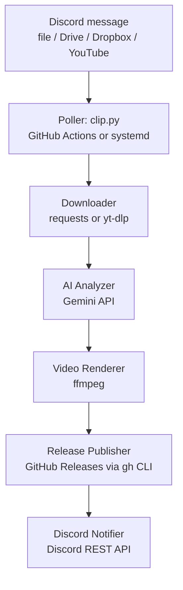

**Read online:** [https://dawoodijaz1999.github.io/Doc-bot/docs/clip-clip.html](https://dawoodijaz1999.github.io/Doc-bot/docs/clip-clip.html)

> Auto-generated from [dawoodijaz1999/clip-clip](https://github.com/dawoodijaz1999/clip-clip) at commit `d3f25cb` on 2026-11-01.

# clip-clip — System Documentation

**Repo:** https://github.com/dawoodijaz1999/clip-clip · **Purpose:** Turn long videos from Discord into 5 vertical clips with AI hooks and captions · **Cost:** Not specified · **Runs:** GitHub Actions (scheduled/manual) or local systemd user service

## 1. Architecture overview

The system runs via GitHub Actions (every 15 minutes) or a local systemd service polling Discord every 30 seconds. A Discord emoji reaction lock (`⏳`) prevents concurrent processing of the same message between cloud and local runners.

## 2. Tools and technologies used
| # | Tool | Purpose | Cost / Limits | Docs |
|---|---|---|---|---|
| 1 | Python | Runtime language (v3.12) | Free, open-source | python.org |
| 2 | Discord API | Bot interface for receiving input messages and posting output clips | Free tier rate limits apply | discord.com |
| 3 | Google Gemini API | Audio analysis, moment selection, hook and caption generation | Free tier or pay-as-you-go | ai.google.dev |
| 4 | ffmpeg / ffprobe | Audio extraction, duration detection, cropping, scaling, text rendering | Free, open-source | ffmpeg.org |
| 5 | yt-dlp | YouTube video downloading | Free, open-source | github.com |
| 6 | Deno | JavaScript runtime dependency for yt-dlp download checks | Free, open-source | deno.com |
| 7 | GitHub Actions | Cloud automation runner for scheduled and dispatched jobs | Free tier delay (1-4 hours) / 90 min timeout | github.com |
| 8 | GitHub Releases | Storage and hosting for generated video clips | 7-day retention policy | github.com |
| 9 | systemd | Local background service supervisor | Free, open-source | systemd.io |

## 3. Project file structure
```text
dawoodijaz1999/clip-clip/
├── .github/
│   ├── keepalive                # Timestamp file updated monthly to prevent workflow disabling
│   └── workflows/
│       ├── clip.yml             # Main runner workflow: checks work, downloads, renders, releases
│       └── keepalive.yml        # Monthly commit workflow to keep schedule active
├── .gitignore                   # Excludes env files, cookies, virtual environments, and media
├── clip.py                      # Core application: polling, downloading, AI prompt, rendering, posting
├── README.md                    # Setup instructions, architecture overview, and operational notes
├── requirements.txt             # Python package dependencies
└── STATUS.md                    # Project development log, fixes, and current status
```

## 4. Configuration (environment variables)
Variables are configured in GitHub Repository Secrets, `.github/workflows/clip.yml` workflow env, or a local `.env` file.

| Variable | Type | Purpose |
|---|---|---|
| `DISCORD_BOT_TOKEN` | Secret | Authenticates bot to read channels, add reactions, and post messages |
| `GEMINI_API_KEY` | Secret | Authenticates requests to Gemini API models |
| `YT_COOKIES` | Secret | Exported browser cookies to bypass YouTube bot blocks on cloud runners |
| `GH_TOKEN` | Secret | GitHub authentication token for releasing assets via `gh` CLI |
| `DISCORD_CHANNEL_ID` | Variable | Target Discord channel ID for monitoring inputs and posting clips |
| `GITHUB_REPOSITORY` | Variable | Target GitHub repo (`dawoodijaz1999/clip-clip` by default) |

## 5. External accounts required
- Discord Developer Portal account: creates the application bot with Message Content Intent enabled.
- Google Cloud / AI Studio account: provides the API key for Gemini models.
- GitHub account: runs GitHub Actions workflows and hosts output clips via Releases.
- Google account (throwaway): exports browser `cookies.txt` for YouTube cloud downloads.

## 6. Known limitations
- GitHub Actions free-tier schedules may face 1-4 hour delays; manual workflow dispatch or local systemd service must be used for immediate runs.
- Direct video uploads and links cannot exceed 500 MB; users must provide external drive links for larger files.
- Google Drive and Dropbox files must be explicitly shared as "Anyone with the link".
- YouTube blocks cloud runners if cookies expire; `YT_COOKIES` must be refreshed manually every few weeks.
- Output release links hosted on GitHub Releases are publicly accessible until deleted.
- Gemini failures trigger evenly spaced clips with generic fallback captions instead of AI-selected highlights.

## 7. Manual/recurring tasks (not automated)
| Task | Frequency |
|---|---|
| Export fresh YouTube `cookies.txt` from desktop browser to update `YT_COOKIES` secret | Every few weeks |
| Dispatch workflow with `test_url` input to verify cookie validity | As needed |
| Resubmit source video links that encountered failures or premature deletions | As needed |

## 8. Reusability for future projects
- The `find_moments` function and JSON prompt schema can be extracted to analyze audio and generate short-form highlights for any video pipeline.
- The ffmpeg 9:16 vertical scaling, center-crop, and hook-text overlay filter chain is modular and adaptable for any vertical video generator.
- The `download_file` logic for Google Drive and Dropbox direct URL conversions can be reused in any media processing tool.
