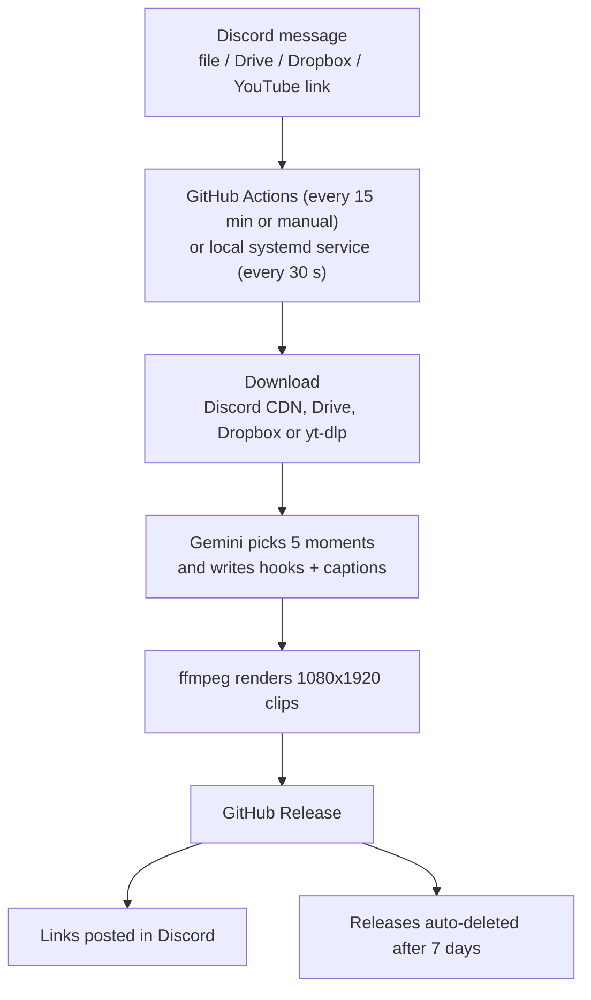

**Read online:** [https://dawoodijaz1999.github.io/Doc-bot/docs/clip-clip.html](https://dawoodijaz1999.github.io/Doc-bot/docs/clip-clip.html)

> Auto-generated from [dawoodijaz1999/clip-clip](https://github.com/dawoodijaz1999/clip-clip) at commit `6a3a594` on 2026-11-03.

# clip-clip — System Documentation

**Repo:** https://github.com/dawoodijaz1999/clip-clip · **Purpose:** Turn long videos into 5 vertical clips with AI hooks and captions from Discord links or files · **Cost:** Free, open-source · **Runs:** GitHub Actions (scheduled/manual) or local systemd user service

## 1. Architecture overview

The cloud runner and local service poll Discord messages, using message reactions as a concurrency lock to avoid processing the same video twice. Processed clips are uploaded to GitHub Releases and posted back to the Discord channel.

## 2. Tools and technologies used
| # | Tool | Purpose | Cost / Limits | Docs |
|---|---|---|---|---|
| 1 | Python | Core application runtime | Free, open-source | python.org |
| 2 | Discord bot | Message polling, user reactions, and chat posting | Free API limits | discord.com |
| 3 | Gemini API | Audio understanding and moment selection | Free / Tiered limits | ai.google.dev |
| 4 | ffmpeg / ffprobe | Video downscaling, cropping, and audio extraction | Free, open-source | ffmpeg.org |
| 5 | yt-dlp | YouTube and streaming media downloader | Free, open-source | github.com |
| 6 | Deno | JavaScript runtime for yt-dlp challenges | Free, open-source | deno.com |
| 7 | GitHub Actions | Cloud-based automated execution runner | Free tier limits | github.com |
| 8 | GitHub Releases | Temporary cloud hosting for generated MP4 clips | Free, 2GB per release limit | github.com |
| 9 | systemd | Local host service manager for continuous polling | Free, OS-native | freedesktop.org |

## 3. Project file structure
```text
clip-clip/
├── .github/
│   ├── keepalive              # Monthly timestamp commit to keep repo active
│   └── workflows/
│       ├── clip.yml           # GitHub Actions cloud runner workflow
│       └── keepalive.yml      # GitHub Actions keepalive workflow
├── clip.py                    # Main application script
├── requirements.txt           # Python package dependencies
├── STATUS.md                  # Development history and testing notes
├── README.md                  # User instructions and documentation
└── .gitignore                 # Ignored local files, outputs, and secrets
```

## 4. Configuration (environment variables)
Set in `.env` for local mode or GitHub Actions repository secrets for cloud mode.

| Variable | Type (Secret / Variable / Code default) | Purpose |
|---|---|---|
| `DISCORD_BOT_TOKEN` | Secret | Authenticate the Discord bot API client |
| `DISCORD_CHANNEL_ID` | Variable | Target Discord channel ID for polling and posting |
| `GEMINI_API_KEY` | Secret | Authenticate calls to the Gemini AI API |
| `YT_COOKIES` | Secret | Optional YouTube cookies text for bypassing bot blocks |
| `GH_TOKEN` | Code default (`github.token`) | Authenticate GitHub CLI release creation and deletion |

## 5. External accounts required
- Discord Developer Account: used to create a bot application and obtain a bot token.
- Google AI Studio Account: used to generate a Gemini API Key for audio analysis.
- YouTube Account (optional): used to export cookies (`YT_COOKIES`) to prevent download blocks on cloud runners.
- GitHub Account: hosts the repository, Actions runner, and temporary Releases storage.

## 6. Known limitations
- GitHub free-tier scheduled runs can be delayed by 1 to 4 hours.
- Video inputs are limited to 500 MB maximum file size.
- Google Drive and Dropbox links must share permissions set to "Anyone with the link".
- YouTube cookies (`YT_COOKIES`) expire every few weeks and require manual refreshing.
- Clip download links are public URLs until the release is automatically deleted after 7 days.

## 7. Manual/recurring tasks (not automated)
| Task | Frequency |
|---|---|
| Refresh YouTube cookies (`YT_COOKIES`) | Every few weeks |

## 8. Reusability for future projects
- The Discord bot polling and reaction-lock pattern is modular and can be reused for other event-driven chat automations.
- The yt-dlp wrapper and direct downloader logic can be extracted for standalone media ingestion pipelines.
- The Gemini API fallback rotation and JSON extraction routine can be reused for resilient LLM tasks.
- The ffmpeg rendering pipeline can be adapted for any automated vertical video generation workflow.
