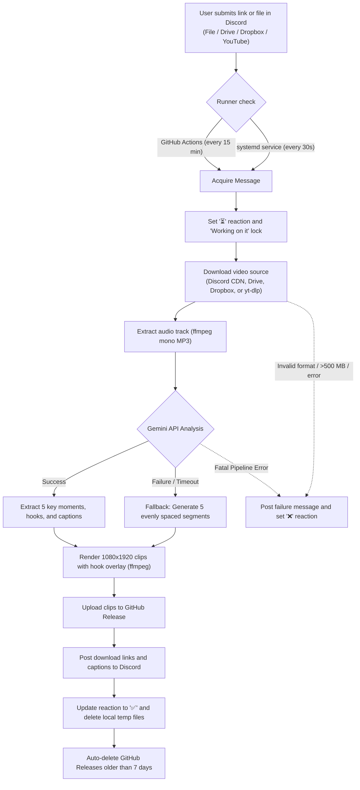

**Read online:** [https://dawoodijaz1999.github.io/Doc-bot/docs/clip-clip.html](https://dawoodijaz1999.github.io/Doc-bot/docs/clip-clip.html)

> Auto-generated from [dawoodijaz1999/clip-clip](https://github.com/dawoodijaz1999/clip-clip) at commit `c451b68` on 2026-10-21.

# clip-clip

Turn long videos into 5 ready-to-post vertical clips with AI hooks and captions, straight from Discord.

## At a glance

| Metric / Parameter | Value |
|---|---|
| Inputs | YouTube links, direct video uploads, Google Drive share links, Dropbox share links, or local file paths |
| Outputs | 1080x1920 MP4 clips with top hook text, captions with hashtags, GitHub Release download links |
| Time | Typically 10 to 30 minutes per video |
| Cost | Free (utilizes free-tier tools, GitHub Actions, and Google Gemini API; exact billing rates not specified) |
| Platforms | Linux (Ubuntu tested), Discord, GitHub Actions, systemd |

## Problem it solves

Content creators need short, engaging vertical clips for platforms like TikTok, YouTube Shorts, and Instagram Reels, but manually watching long-form videos to identify highlights, calculate timestamps, crop to vertical format, generate overlays, and draft captions is time-consuming. 

`clip-clip` automates this process directly through Discord. Users drop a video file or link, and the system extracts highlights, crops the footage, generates hooks and captions, and returns downloadable clips.

## What it does

- Accepts video inputs via Discord messages (attachments, Google Drive, Dropbox, or YouTube links) or local command-line inputs.
- Extracts single-channel compressed audio and uses Google Gemini to detect the 5 strongest 30- to 60-second moments tailored for TikTok audiences (focused on Pakistani vlogs in Urdu/Punjabi).
- Automatically writes Roman Urdu hook lines (up to 28 characters) and TikTok captions with hashtags.
- Falls back to evenly spaced cuts and template captions if the AI service fails or runs out of quota.
- Uses `ffmpeg` to crop and scale horizontal footage to 1080x1920 vertical video (9:16 aspect ratio) at 30 fps, burning in top-positioned hook text overlays.
- Hosts rendered clips on GitHub Releases and posts the links back into the Discord thread.
- Automatically deletes releases older than 7 days to conserve storage.

## Full workflow, step by step

1. **Trigger and Detection**: A user posts a video file, Google Drive link, Dropbox link, or YouTube link to a designated Discord channel.
2. **Scheduling / Polling**: The job is detected either by GitHub Actions (polling every 15 minutes or triggered manually) or by a local systemd background service (polling every 30 seconds).
3. **Locking**: The bot adds an hourglass (`⏳`) reaction to the message and posts a "Working on it" reply, locking the job so concurrent runners do not process it twice.
4. **Acquisition**: The video is downloaded to a local working directory (`work/<key>/`) using `requests` (for direct files, Drive, and Dropbox) or `yt-dlp` backed by Deno and authentication cookies (for YouTube).
5. **Validation**: Files are checked to ensure they are playable, under 500 MB, and at least 30 seconds long.
6. **AI Analysis**: `ffmpeg` extracts a 32 kbps mono MP3 audio track. The track is uploaded to Google Gemini to find up to 5 non-overlapping, highlight moments (30 to 60 seconds each) with hook lines and captions.
7. **Rendering**: `ffmpeg` crops and scales each selected segment to 1080x1920 at 30 fps, encoding via `libx264` (CRF 18) and `aac` audio, and overlays the hook text centered near the top.
8. **Publishing**: Rendered files are published to a GitHub Release tagged as `clips-<message_id>`.
9. **Notification**: Download URLs, timestamps, hooks, and suggested captions are posted back as Discord message replies.
10. **Completion and Cleanup**: The bot swaps the `⏳` reaction for a `✅` (or `❌` on failure), deletes the local working directory, and purges any GitHub Releases older than 7 days.



## Architecture

The system operates using a decoupled, dual-runner design:

- **Orchestration / Polling Layer**: Can run as a cloud worker inside GitHub Actions or locally as a user-level `systemd` background service via `clip.py --watch`.
- **Locking Mechanism**: Discord message reactions (`⏳`) combined with a timestamped "Working on it" message serve as a distributed lock. If a lock is older than 2 hours (`LOCK_HOURS`), it is considered crashed and re-processed.
- **Media Engine**: `yt-dlp` handles YouTube streaming with Deno providing the JavaScript runtime. Standard downloads use streaming `requests`. Processing and rendering are handled by `ffmpeg` and `ffprobe`.
- **Intelligence Layer**: The `google-genai` SDK interfaces with Gemini models using a tiered fallback list: `gemini-flash-latest` (two attempts), `gemini-3.5-flash`, and `gemini-flash-lite-latest`.
- **Asset Distribution**: Assets are hosted directly on GitHub Releases associated with the repository, eliminating the need for dedicated file-hosting servers.

## Tools and technologies

| Tool / Technology | What it is | Role in this project | Cost |
|---|---|---|---|
| Python 3.12 | Programming language | Core execution runtime for `clip.py` | Free / Open Source |
| Google Gemini API | Multimodal AI service | Listens to audio, identifies clip timestamps, writes hooks and captions | Free tier available (exact cost not specified) |
| ffmpeg / ffprobe | Audio and video processing CLI | Extracts audio, inspects duration, scales, crops, and burns text overlays | Free / Open Source |
| yt-dlp | Video downloader | Downloads video streams from YouTube | Free / Open Source |
| Deno | Modern JavaScript runtime | Executes JS extraction scripts required by `yt-dlp` for YouTube | Free / Open Source |
| Discord REST API (v10) | Bot and messaging platform | Ingests inputs, communicates status, and distributes clip links | Free |
| GitHub Actions | CI/CD automation platform | Scheduled cloud runner executing the pipeline every 15 minutes | Free tier available |
| GitHub Releases | Release and binary hosting | Public hosting and distribution point for rendered video clips | Free |
| systemd | Linux service manager | Manages the background user daemon for local mode execution | Free / Open Source |
| DejaVu Sans Bold | TrueType Font | Typography burned onto clips for top hook text overlays | Free / Open Source |

## Inputs and outputs

### Inputs
- **Supported Link Types**:
  - YouTube video URLs (standard, short, or live links).
  - Google Drive share links (must be set to "Anyone with the link").
  - Dropbox share links (must be set to "Anyone with the link").
- **Direct File Uploads**: Video attachments up to 500 MB with extensions `.mp4`, `.mov`, `.mkv`, or `.webm`.
- **Video Requirements**: Must be playable by `ffprobe` and have a duration of at least 30 seconds.

### Outputs
- **Rendered Video**:
  - 5 vertical clips (fewer if the source video is too short to support 5 non-overlapping clips).
  - Dimensions: 1080x1920 (9:16 vertical crop).
  - Frame rate: 30 fps.
  - Video codec: H.264 (`libx264`, CRF 18, high profile, `yuv420p`).
  - Audio codec: AAC (192 kbps, 44.1 kHz).
  - Duration: 30 to 60 seconds per clip.
  - Hook overlay: Text burned in near top (`y=260`), white text with a 65% black background box.
- **Discord Messages**:
  - Message with source title and download links to GitHub Releases.
  - Individual messages per clip containing clip index, start-to-end timestamps, hook text, download URL, and TikTok captions with hashtags.

## Reliability and error handling

- **State and Concurrency Locks**: Discord reaction states (`⏳`, `✅`, `❌`) prevent runner overlap between cloud and local instances. Stale locks older than 2 hours are automatically reclaimed and retried.
- **AI Fallback Chain**: If a Gemini model fails, the system waits 15 seconds and cycles sequentially through:
  1. `gemini-flash-latest` (Attempt 1)
  2. `gemini-flash-latest` (Attempt 2)
  3. `gemini-3.5-flash`
  4. `gemini-flash-lite-latest`
- **Evenly Spaced Fallback**: If Gemini fails completely (due to quota, network, or invalid keys), the pipeline falls back to cutting 45-second evenly spaced segments across the video with generic hooks and fallback hashtags (`#viral #foryou #fyp #pakistan #trending`), alerting the user in Discord.
- **YouTube 403 Mitigations**: Uses 10 MB chunked downloads, 10 retries, and Deno as the JavaScript runtime. On 403 errors, temporary download fragments are unlinked, the thread sleeps for 10 seconds, and it re-attempts extraction.
- **User Input Errors**: Informative messages are sent to Discord for files larger than 500 MB, unplayable formats, videos under 30 seconds, or private Drive/Dropbox/YouTube links.
- **Rate Limit Management**: Discord API interactions handle HTTP 429 backoff responses automatically by reading `retry_after`.

## Security

- **Secrets Handling**: API keys and tokens are loaded from repository secrets (GitHub Actions) or `.env` files (local). They are never hardcoded.
  - `DISCORD_BOT_TOKEN`
  - `GEMINI_API_KEY`
  - `YT_COOKIES`
  - `GH_TOKEN` (provided via GitHub Actions context)
- **Account Isolation**: YouTube cookies should be sourced from an isolated throwaway account; YouTube may challenge or flag automated cloud downloads.
- **Public URL Exposure**: Uploaded video assets are stored on public GitHub Releases, meaning anyone with the URL can download the file until the release is pruned after 7 days.
- **Repo Sanitization**: Local secrets (`.env`, `cookies.txt`), media files (`*.mp4`, `*.mp3`, etc.), and working folders (`work/`, `out/`) are explicitly excluded via `.gitignore`.

## Setup and configuration

### 1. Discord Bot Configuration
1. Create a Discord application in the Discord Developer Portal and add a bot.
2. Enable **Message Content Intent** in the bot settings.
3. Invite the bot to your Discord server with permissions:
   - View Channels
   - Send Messages
   - Attach Files
   - Read Message History
   - Add Reactions
4. Note your target Discord Channel ID.

### 2. Cloud Mode (GitHub Actions)
1. Add the following GitHub Repository Secrets under **Settings > Secrets and variables > Actions**:
   - `DISCORD_BOT_TOKEN`: Discord Bot authentication token.
   - `GEMINI_API_KEY`: Google Gemini API key.
   - `YT_COOKIES`: Plaintext `cookies.txt` exported from a separate Google account.
2. Ensure the channel ID is specified in `.github/workflows/clip.yml` under the `DISCORD_CHANNEL_ID` environment variable.
3. Workflows:
   - `clip.yml`: Checks every 15 minutes for new work and processes up to 2 videos per execution.
   - `keepalive.yml`: Runs monthly to commit a timestamp to `.github/keepalive` and re-enable `clip.yml`, preventing GitHub from disabling scheduled runs after 60 days of inactivity.

### 3. Local Mode (systemd Service)
1. Clone the repository and set up a Python virtual environment:
   ```bash
   python3 -m venv .venv
   .venv/bin/pip install -r requirements.txt
   ```
2. Install system dependencies: `ffmpeg`, `fonts-dejavu-core` (or DejaVu Sans Bold), and `gh` (GitHub CLI, authenticated via `gh auth login`).
3. Create a `.env` file in the project root:
   ```env
   DISCORD_BOT_TOKEN="your_discord_bot_token"
   DISCORD_CHANNEL_ID="your_discord_channel_id"
   GEMINI_API_KEY="your_gemini_api_key"
   ```
4. Configure a systemd user service at `~/.config/systemd/user/clip-clip.service`:
   ```ini
   [Service]
   WorkingDirectory=/path/to/clip-clip
   ExecStartPre=-/path/to/clip-clip/.venv/bin/pip install -q -U "yt-dlp[default]"
   ExecStart=/path/to/clip-clip/.venv/bin/python -u clip.py --watch
   Restart=always

   [Install]
   WantedBy=default.target
   ```
5. Enable and launch the service:
   ```bash
   systemctl --user enable --now clip-clip
   ```

## Usage guide

### Via Discord
- **Post a Video File**: Attach an `.mp4`, `.mov`, `.mkv`, or `.webm` video (up to 500 MB) directly in the monitored channel.
- **Post a Cloud Link**: Post a public Google Drive or Dropbox link configured as "Anyone with the link".
- **Post a YouTube Link**: Post any YouTube standard, live, or Short link.
- The bot acknowledges with `⏳` and replies "Working on it... clips in about 10-20 minutes." Once complete, links, timestamps, and captions are posted, and the reaction changes to `✅`.

### Local CLI Execution
Process a video file or link directly on the host machine without posting to Discord or GitHub:
```bash
# Process a local video file
.venv/bin/python clip.py --local path/to/video.mp4

# Process a web link locally
.venv/bin/python clip.py --local "https://www.youtube.com/watch?v=..."
```
Rendered clips are saved to the `out/<key>/` directory.

### Manual Cloud Workflow / Cookie Verification
Under GitHub Actions:
1. Select the **clip** workflow.
2. Click **Run workflow**.
3. (Optional) Provide a link in the `test_url` input. This runs an isolated 20-second download check using `YT_COOKIES` to verify YouTube has not blocked the runner.

## Maintenance tasks

- **Cookie Refreshing**: `YT_COOKIES` must be re-exported from a desktop browser and updated in GitHub Secrets every few weeks to prevent YouTube 403 / bot-check failures on cloud runners.
- **yt-dlp Updates**: The systemd service auto-updates `yt-dlp` upon start, but local installations running manually must run `pip install -U "yt-dlp[default]"` periodically.
- **Release Pruning**: Completed clips on GitHub Releases are automatically deleted after 7 days by `cleanup_old_releases()` during regular runs.
- **Keepalive Maintenance**: The `keepalive.yml` workflow runs automatically on the 1st of every month to prevent GitHub from disabling scheduled runs in public repositories.

## Limitations

- **Free-Tier Scheduling Delays**: GitHub Actions free-tier scheduled runs (`cron`) can experience delays between 1 and 4 hours.
- **File Size Restrictions**: Direct attachments and cloud drive downloads are restricted to a maximum of 500 MB. Free Discord accounts have lower attachment limits.
- **Sharing Configuration**: Google Drive and Dropbox files must be explicitly shared with permissions set to "Anyone with the link".
- **YouTube Cloud Blocks**: YouTube frequently blocks cloud data center IP addresses (like GitHub Actions runners), requiring valid and updated cookies.
- **Public Visibility**: Because clips are hosted using GitHub Releases, asset URLs are publicly accessible on the web until purged.
- **Content Focus**: Prompting is tailored specifically to Pakistani vlogs in Urdu or Punjabi, which may require prompt changes for other languages.

## Costs

- **Infrastructure**: Not specified (runs on GitHub Actions free minutes or self-hosted hardware via systemd).
- **Discord Bot**: Free.
- **GitHub Releases Hosting**: Free (temporary 7-day retention).
- **Gemini API**: Free tier available (specific paid consumption pricing is not specified).

## Possible future improvements

- Expansion beyond Urdu/Punjabi vlogs to generalize hook generation and prompt parameters.
- Direct upload support for full cloud runs without relying on manual cookie refreshes.
- Support for customizable clip counts and target durations beyond the hardcoded 5 clips (30-60s).
