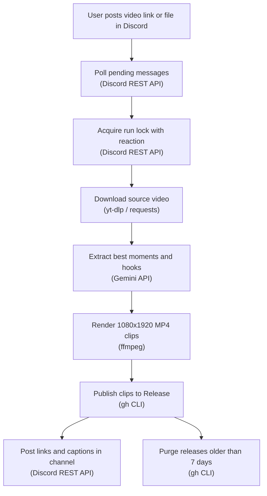

**Read online:** [https://dawoodijaz1999.github.io/Doc-bot/docs/clip-clip.html](https://dawoodijaz1999.github.io/Doc-bot/docs/clip-clip.html)

> Auto-generated from [dawoodijaz1999/clip-clip](https://github.com/dawoodijaz1999/clip-clip) at commit `c451b68` on 2026-10-21.

# clip-clip — System Documentation

**Repo:** https://github.com/dawoodijaz1999/clip-clip · **Purpose:** Turn long videos into 5 vertical clips with AI hooks and captions via Discord · **Cost:** Free (using free-tier services) · **Runs:** GitHub Actions or local systemd service

## 1. Architecture overview



The system runs either automatically every 15 minutes via GitHub Actions or continuously on a local machine via a systemd background service polling every 30 seconds. An hourglass reaction on the source message acts as a run lock to prevent simultaneous processing across both runners.

## 2. Tools and technologies used

| # | Tool | Purpose | Cost / Limits | Docs |
|---|---|---|---|---|
| 1 | Python 3.12 | Core application runtime | Free, open-source | python.org |
| 2 | Discord REST API | Message ingestion, reaction-based job locking, and delivery | Free / Rate limits apply | discord.com |
| 3 | Gemini API | Audio understanding, selecting 30-60s moments, and hook generation | Free tier available / Quota limits | ai.google.dev |
| 4 | ffmpeg / ffprobe | Audio conversion, video scaling, 9:16 cropping, and text overlay | Free, open-source | ffmpeg.org |
| 5 | yt-dlp | Downloading YouTube video streams | Free, open-source | github.com |
| 6 | Deno | JavaScript runtime required by yt-dlp for YouTube extraction | Free, open-source | deno.land |
| 7 | GitHub Actions | Cloud cron scheduler and workflow execution runner | Free tier available (delays possible) | github.com |
| 8 | GitHub Releases (`gh` CLI) | Temporary hosting for rendered MP4 clip downloads | Free / Subject to repo storage limits | cli.github.com |
| 9 | systemd | Local service supervisor for 24/7 background polling | Free, open-source | systemd.io |

## 3. Project file structure

```text
clip-clip/
├── .github/
│   └── workflows/
│       ├── clip.yml          # GitHub Actions workflow running checks, clipping jobs, or cookie tests
│       └── keepalive.yml     # Monthly scheduled commit to prevent GitHub Actions workflow deactivation
├── .gitignore                # Exclusion rules for virtual environments, outputs, and secrets
├── clip.py                   # Main CLI script handling polling, downloading, AI analysis, rendering, and posting
├── requirements.txt          # Python dependencies (requests, yt-dlp, google-genai, deno)
├── README.md                 # Project documentation and setup instructions
└── STATUS.md                 # Development notes, live testing status, and changelog
```

## 4. Configuration (environment variables)

Environment variables are set in GitHub Actions repository secrets for cloud execution or in a local `.env` file for systemd execution.

| Variable | Type (Secret / Variable / Code default) | Purpose |
|---|---|---|
| `DISCORD_BOT_TOKEN` | Secret | Bot credentials for Discord REST API access |
| `DISCORD_CHANNEL_ID` | Code default / Variable | Channel ID monitored for video submissions |
| `GEMINI_API_KEY` | Secret | Authentication key for Google Gemini model requests |
| `YT_COOKIES` | Secret | Netscape-formatted YouTube cookies for cloud runner requests |
| `GH_TOKEN` | Secret | GitHub authentication token for creating and deleting releases |
| `GITHUB_REPOSITORY` | Code default / Variable | Target repository identifier (defaults to `dawoodijaz1999/clip-clip`) |

## 5. External accounts required

- Discord Developer Account: Creates the bot user with Message Content Intent to monitor channels and send messages.
- Google AI Studio: Provides the API key required for Gemini audio models.
- YouTube / Google Account: Supplies session cookies from an export extension to bypass cloud bot checks.
- GitHub Account: Hosts the code, runs GitHub Actions workflows, and hosts release artifacts.

## 6. Known limitations

- Cloud execution delays: Free GitHub Actions schedules can be delayed by 1 to 4 hours; manual workflow dispatch or the local systemd service avoids this delay.
- YouTube cloud IP blocks: Cloud IP addresses may face 403 errors or bot prompts; workaround requires maintaining valid session cookies via `YT_COOKIES`.
- Input file size restriction: Video files and link targets are capped at 500 MB.
- Public asset exposure: Uploaded clips in GitHub Releases remain public until automatically pruned after 7 days.
- Cloud link sharing settings: Google Drive and Dropbox links fail unless configured with public read access.
- Minimum input length: Input media must be at least 30 seconds long to produce clips.

## 7. Manual/recurring tasks (not automated)

| Task | Frequency |
|---|---|
| Refresh `YT_COOKIES` secret from a desktop browser | Every few weeks |
| Trigger manual workflow dispatch for immediate cloud processing | As needed |
| Clear failed reaction marks on Discord to retry stuck messages | As needed |

## 8. Reusability for future projects

- AI moment detection (`find_moments`): Isolated logic uploading audio to Gemini with multi-model fallbacks can be adapted for any speech-to-clip pipeline.
- Video reformatting engine (`render`): Standalone ffmpeg filter pipeline can be reused to convert horizontal video to 1080x1920 vertical format with centered text hooks.
- Unified media downloader (`get_source`): Ingestion layer seamlessly handling attachments, Drive, Dropbox, and YouTube URLs can be repurposed for other media bots.
- GitHub Releases asset lifecycle (`publish` and `cleanup_old_releases`): Ephemeral storage pattern with automated age-based cleanup can serve any automated artifact distribution workflow.
