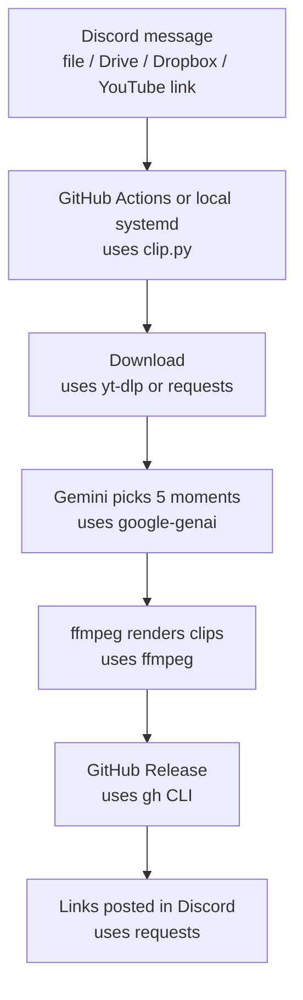

**Read online:** [https://dawoodijaz1999.github.io/Doc-bot/docs/clip-clip.html](https://dawoodijaz1999.github.io/Doc-bot/docs/clip-clip.html)

> Auto-generated from [dawoodijaz1999/clip-clip](https://github.com/dawoodijaz1999/clip-clip) at commit `fd8613d` on 2026-10-30.

# clip-clip — System Documentation

**Repo:** https://github.com/dawoodijaz1999/clip-clip · **Purpose:** Convert long videos into 5 vertical clips with AI hooks and captions from Discord · **Cost:** Free, open-source · **Runs:** GitHub Actions or local systemd service

## 1. Architecture overview

Triggered by Discord messages containing video links or files. Processed either by a scheduled GitHub Action or a local systemd service running `clip.py --watch`.

## 2. Tools and technologies used
| # | Tool | Purpose | Cost / Limits | Docs (domain only) |
|---|---|---|---|---|
| 1 | Python 3.12 | Core runtime | Free, open-source | python.org |
| 2 | Gemini API | Audio understanding and clip selection | Usage-based / Free tiers | ai.google.dev |
| 3 | ffmpeg | Video cropping and rendering | Free, open-source | ffmpeg.org |
| 4 | yt-dlp | YouTube video downloads | Free, open-source | github.com |
| 5 | Deno | JavaScript runtime for yt-dlp | Free, open-source | deno.com |
| 6 | Discord Bot API | Message reading, reaction locks, and replies | Free API | discord.com |
| 7 | GitHub Actions & Releases | Cloud execution and temporary file hosting | Free tier limits | github.com |
| 8 | systemd | Local background service runner | Free, built-in | freedesktop.org |

## 3. Project file structure
```text
clip-clip/
├── clip.py              # Main application script handling polling, downloads, Gemini, and rendering
├── requirements.txt     # Python package dependencies
├── STATUS.md            # Daily logs and release notes
├── README.md            # User setup and documentation
├── .gitignore           # Git exclusion rules for secrets and media
└── .github/
    ├── keepalive.yml    # Monthly GitHub Actions activity workflow
    └── workflows/
        └── clip.yml     # Cloud runner scheduled every 15 minutes
```

## 4. Configuration (environment variables)
Set via GitHub repository secrets (Cloud mode) or a local `.env` file next to `clip.py` (Local mode).

| Variable | Type | Purpose |
|---|---|---|
| `DISCORD_BOT_TOKEN` | Secret | Read channel messages and post replies |
| `DISCORD_CHANNEL_ID` | Variable | Target Discord channel identifier |
| `GEMINI_API_KEY` | Secret | Authenticate requests to the Gemini API |
| `YT_COOKIES` | Secret | YouTube cookies text block to bypass cloud bot checks |
| `GH_TOKEN` | Secret | GitHub token for creating and cleaning up releases |

## 5. External accounts required
- Discord Developer Account: used to create a bot application and access a channel.
- Google Gemini API Account: used to generate AI hooks, captions, and timestamp selections.
- GitHub Account: used for cloud runners, GitHub Releases hosting, and repository automation.
- Google Account (optional): used to supply `YT_COOKIES` for bypassing YouTube download restrictions.

## 6. Known limitations
- GitHub free-tier scheduled runs can be delayed by 1-4 hours; use manual workflow dispatch or local service for immediate execution.
- File inputs are strictly limited to 500 MB; larger files must use external share links.
- Google Drive and Dropbox links require permissions set to "Anyone with the link".
- YouTube cookies blockages require manual cookie file refreshes every few weeks.
- Clip download links remain public URLs until GitHub releases are auto-deleted after 7 days.

## 7. Manual/recurring tasks (not automated)
| Task | Frequency |
|---|---|
| Refresh `YT_COOKIES` secret when YouTube blocks downloads | Every few weeks |

## 8. Reusability for future projects
- Discord bot polling and reaction-lock pattern can be reused for other asynchronous task queues.
- The yt-dlp wrapper with Deno runtime integration is modular for any YouTube ingestion pipeline.
- The Gemini API fallback model chain and JSON cleaning logic can be swapped into other AI processing scripts.
- The ffmpeg rendering step with dynamic text scaling can be adapted for automated short-form video generation.
